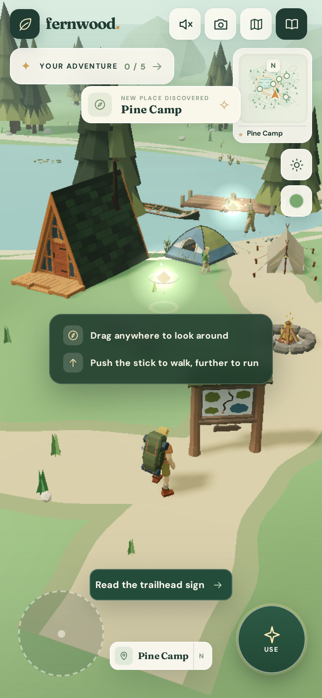

# Fernwood — a little open world to wander

A small, playable open-world game that runs in the browser. Wander a low-poly forest, meet the locals, and find five lost wayfinder charms. Built with [Three.js](https://threejs.org) and real [Polyfork](https://polyfork.dev) GLB models.

Playable with a keyboard and mouse on desktop, or with thumbs on a phone — a thumbstick, a big action button, tap-to-look and pinch-to-zoom all come built in.



## What's in the world

- Six discoverable places: Pine Camp, Bluewater Dock, Old Pine Cabin, The Swing Tree, Whispering Pines, The Lookout
- Five collectible wayfinder charms, saved to `localStorage`
- 3 sky settings (morning / golden hour / after dusk) and 3 seasons (summer / autumn / winter) that repaint the ground, grass, snow and leaves
- A field guide with a live map, journal, how-to-play and full model credits
- Photo mode, ambient forest audio, and a minimap that tracks where you are

## Controls

**Desktop**

| Action | Input |
| --- | --- |
| Walk | `W` `A` `S` `D` or arrow keys |
| Run | `Shift` while moving |
| Look / zoom | Drag mouse / scroll wheel |
| Talk, read, collect | `E` or `Space` |
| Map / journal / photo | `M` / `J` / `P` |
| Close a window | `Esc` |

**Mobile**

| Action | Input |
| --- | --- |
| Walk | Push the stick in the lower-left (appears where you touch) |
| Run | Push the stick all the way out |
| Look / zoom | Drag anywhere on the world / pinch |
| Talk, read, collect | Tap the round **USE** button |

The layout adapts to portrait, landscape, small phones (down to 320 px) and tablets, respects notch safe areas, and steps its render resolution down automatically if a device starts dropping frames.

## Run it locally

It's a static site with no build step. Any static server works:

```bash
python3 -m http.server 8000
# then open http://localhost:8000
```

Opening `index.html` straight from the filesystem will not work — ES module imports and the GLB loader need `http://`.

## Deploy to Vercel

Zero configuration required:

1. Import the GitHub repo at [vercel.com/new](https://vercel.com/new).
2. Framework preset: **Other**. Build command: *(none)*. Output directory: *(root, leave default)*.
3. Deploy.

Or from the CLI:

```bash
npm i -g vercel
vercel --prod
```

`vercel.json` adds long-lived caching for the model, font and vendor files so repeat visits load instantly.

## Project layout

```
index.html      markup, HUD, inline SVG icon sprites
styles.css      design system + desktop and touch layouts
app.js          Three.js scene, world generation, game loop, input
assets/models   26 Polyfork GLB models
assets/fonts    self-hosted DM Sans + Fraunces
vendor          Three.js r158 (MIT) + GLTFLoader, vendored for offline use
campground-kit.md  reference notes for the Polyfork Campground kit
tests           Playwright scripts used to verify the mobile build
```

## Credits & licensing

- **3D models:** [Polyfork](https://polyfork.dev) by Lucas Martinic — the free low-poly library, used under [CC BY 4.0](https://creativecommons.org/licenses/by/4.0/). The 26 bundled `.glb` files are unmodified. Each one is linked to its model page inside the game's **Credits** tab.
- **Three.js:** MIT licensed.
- Everything else — the terrain, trails, charm effects, lighting, seasons, interactions and interface — was written for this project.

Fernwood is an independent demo and is not endorsed by Polyfork.
