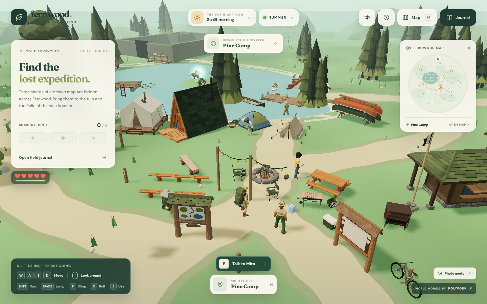
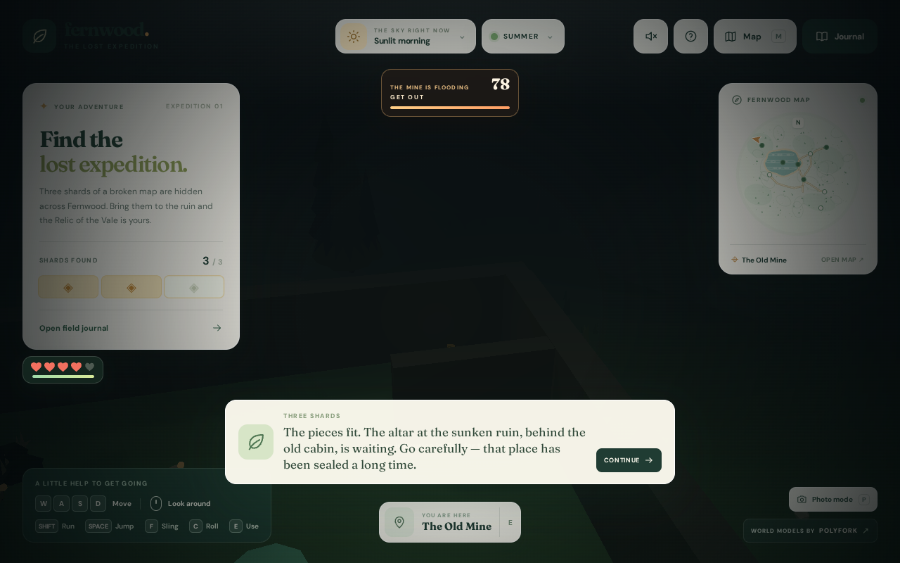

# Fernwood — The Lost Expedition

A small, playable open-world adventure that runs in the browser. Three shards of a broken map are hidden across a low-poly forest: one on a fog island in the middle of a lake, one at the top of a quarry climb, one at the bottom of a flooded mine. Bring all three to the altar in the sunken ruin, take the relic, and get out before the roof comes down.

Built with [Three.js](https://threejs.org) and real [Polyfork](https://polyfork.dev) GLB models. No build step, no dependencies to install — it is static HTML, CSS and ES modules.

**Desktop:** keyboard + mouse. **Phone:** thumbstick, big action button, jump and dodge buttons, tap-to-look, pinch-to-zoom.






## The expedition

| Step | Where | What you do |
| --- | --- | --- |
| 1 | Bluewater Dock | Take the paddle, board the canoe, row across the fog lake |
| 2 | The Fog Islet | Beach the canoe and take the **Fog Shard** |
| 3 | The Lookout | Walk up the quarry columns, take the **Sky Shard** |
| 4 | The Old Mine | Light the lantern, shove the stone onto the weight plate, take the **Deep Shard** — the mine starts flooding, 78 seconds |
| 5 | The Sunken Ruin | The altar needs all three shards. It opens, the ruin starts to collapse (46 seconds), and the escape ring is through the south doorway |

Progress (paddle, lantern, relic and the three shards) is saved to `localStorage`, and a **Save tweaks** style reset is one button away in the journal.

### Combat

Five hearts, a stamina bar, and a slingshot. Hounds patrol the islet, the quarry and the mine. They circle, wind up for an audible half-second, then lunge — roll through the lunge with `C` / **DODGE**, or put a sling stone in them first (two hits). Running drains stamina; it refills when you stop. Hit a hound and it flashes white and backs off. Three hits and you go down, then wake up at camp with your shards intact.

## What's in the world

- All 62 models from the Polyfork *Campground & Lake* kit are in the world — every canoe, cooler, camp stove, trailer, boardwalk and trail marker has a home
- Nine discoverable places, three of them gated: the fog lake, the quarry climb, the flooded mine
- A weight-plate puzzle in the mine (shove the stone, the gate opens)
- Two timed sequences: the mine flood and the ruin collapse
- 3 sky settings (morning / golden hour / after dusk) and 3 seasons (summer / autumn / winter) that repaint the ground, grass, snow and leaves
- A field guide with a live map, journal, how-to-play and full model credits
- Photo mode, ambient forest audio, and a minimap that tracks where you are

## Controls

**Desktop**

| Action | Input |
| --- | --- |
| Walk / run | `W` `A` `S` `D` (or arrows), `Shift` to run |
| Jump | `Space` |
| Roll / dodge | `C` |
| Fire the slingshot | `F` |
| Use, talk, take, board | `E` |
| Look / zoom | Drag mouse / scroll wheel |
| Map / journal / photo | `M` / `J` / `P` |
| Close a window | `Esc` |

**Mobile**

| Action | Input |
| --- | --- |
| Walk / run | Push the stick bottom-left, further to run |
| Jump / roll | The **JUMP** and **DODGE** buttons, bottom-right |
| Use / fire | The big button — it reads `USE` when something is close, `FIRE` when nothing is |
| Look / zoom | Drag the world, pinch with two fingers |

The stick spawns wherever your thumb lands, so you never have to find a fixed circle.

## Running it locally

The game loads ES modules and `.glb` models, so it needs a server (not `file://`):

```bash
python3 -m http.server 8000
# then open http://127.0.0.1:8000
```

## Deploying

The repo is static. On Vercel: **Add New → Project → import this repo → framework preset "Other"**, no build command, output directory `.` — `vercel.json` takes care of caching and headers.

## Project layout

```
index.html          markup, HUD, SVG icons
styles.css          all styling, including the mobile HUD
app.js              the whole game: world build, movement, camera, adventure layer
assets/models/      62 GLB props from Polyfork
assets/fonts/       display + interface fonts
vendor/             three.module.js and GLTFLoader
tests/              Playwright scripts and screenshots used to verify the build
screenshots/        what you see above
```

## Credits

All models are from the [Polyfork](https://polyfork.dev) campground collection and are used unmodified. The land, trails, mine, ruin, climb, creatures, lighting, seasons, combat and interface were made for this game.

Open the in-game **Journal → Credits** for the full model list.
